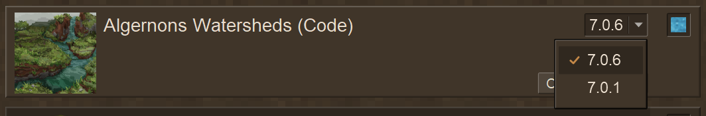
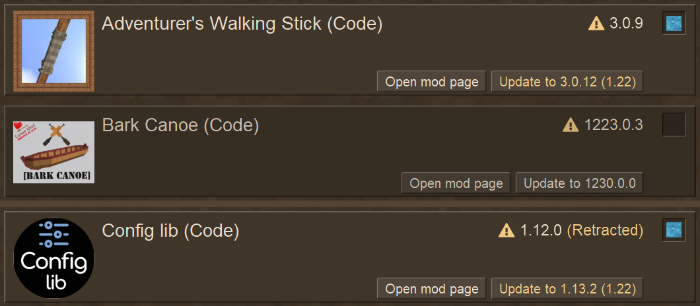
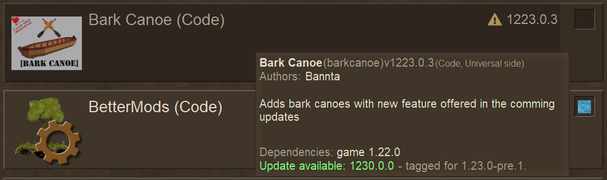
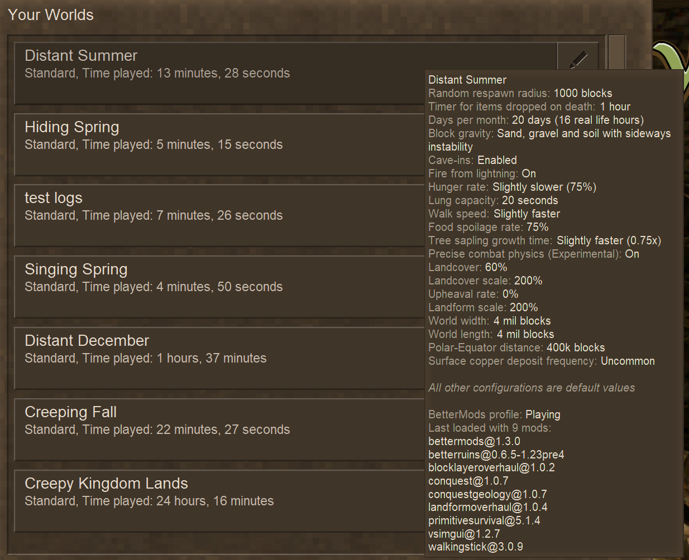

# Lets be clear: this is a filthy Hack of a mod
This mod introduces features I believe should be stock in the game, and I hope the developers look at this and say "oh yes, he is correct; this is how it should be" and then implement everything it does. They don't even need to say thank you, I'll know ;3

## Why is this a hack? Because it requires abusing .net to do what I want

Vintage Story runs no mod code before a world loads - the main menu only reads mod metadata. So on
a normal launch the Mods screen stays vanilla until you have loaded a world once that session.

The fix is a small **.NET startup hook**, `BetterModsHook.dll`, which the .NET runtime itself runs
before the game starts. It waits for the game to finish starting, then loads BetterMods' patches,
so the profile tabs are there from the very first screen. It does nothing else, and it changes
nothing once a world is loaded.

The catch: .NET only runs a startup hook when the `DOTNET_STARTUP_HOOKS` environment variable names
it, and a mod has no way to set that for the game. So BetterMods makes a **custom desktop shortcut**,
*Vintage Story (BetterMods)*, from the **Add Shortcut** button on its own mod card. The shortcut sets
that variable for that one launch only - and only if the hook file is actually there - then starts
the game. Launch from the shortcut and the hook runs; launch the game normally and everything stays
vanilla until a world loads. Nothing on your system is changed globally. See
[Loading at startup](#loading-at-startup-the-startup-hook).

# BetterMods

Mod **profiles** for Vintage Story's mod manager + custom "Playstyles". Keep named sets of enabled and disabled mods,
switch between them with one click, pick which installed version of a mod each profile uses, and
update your mods from the mod DB - all inside the game's own Mods screen.


| | |
|---|---|
| Side | **Client only.** Servers neither need nor see it; it works on any server. |
| Game version | **Vintage Story 1.23.0-pre.1 or newer** (1.23.x). For 1.22, use the BetterMods 1.2.0 release. |
| Open it | Main menu: **Mods** screen. In game: the **Mod Profiles** dialog - bind a key to it under **Settings > Controls** (none by default). |
| Restart needed? | Only when a profile switches a mod you already used this session to a *different version*. Enabling and disabling mods never needs one. |

## Contents

- [Lets be clear: this is a filthy Hack of a mod](#lets-be-clear-this-is-a-filthy-hack-of-a-mod)
  - [Why is this a hack? Because it requires abusing .net to do what I want](#why-is-this-a-hack-because-it-requires-abusing-net-to-do-what-i-want)
- [BetterMods](#bettermods)
  - [Contents](#contents)
  - [Installing](#installing)
  - [Loading at startup (the startup hook)](#loading-at-startup-the-startup-hook)
    - [The easy way: Add Shortcut (Windows)](#the-easy-way-add-shortcut-windows)
    - [What the shortcut does](#what-the-shortcut-does)
    - [BetterMods installs and updates the hook itself](#bettermods-installs-and-updates-the-hook-itself)
    - [Making the shortcut by hand (Windows)](#making-the-shortcut-by-hand-windows)
    - [Linux and macOS](#linux-and-macos)
  - [Profiles](#profiles)
  - [The in-game Mod Profiles dialog](#the-in-game-mod-profiles-dialog)
    - [Mod cards](#mod-cards)
    - [Several versions of one mod](#several-versions-of-one-mod)
    - [Update checking](#update-checking)
    - [Open mod page and trusted links](#open-mod-page-and-trusted-links)
    - [Fix dependencies](#fix-dependencies)
    - [Core-mod protection](#core-mod-protection)
  - [Worlds remember their profile and mods](#worlds-remember-their-profile-and-mods)
  - [Saved playstyles (Accepted feature creep)](#saved-playstyles-accepted-feature-creep)
    - [For mod authors: the `.vsplaystyle` format](#for-mod-authors-the-vsplaystyle-format)
  - [Multiplayer](#multiplayer)
  - [Network use](#network-use)
  - [Safety and fallbacks](#safety-and-fallbacks)
  - [Where BetterMods keeps its data](#where-bettermods-keeps-its-data)
  - [Uninstalling](#uninstalling)
  - [Known limitations](#known-limitations)
  - [Troubleshooting and bug reports](#troubleshooting-and-bug-reports)
  - [Releases](#releases)
  - [License](#license)

## Installing

1. Click the one-click link thing
2. Confirm
3. Open a world, then exit back to the main menu. BetterMods can't do anything until a world has loaded once - that's the hack.
4. In **Mods**, click **Add Shortcut** on BetterMods' own card (Windows; on Linux/macOS see [Linux and macOS](#linux-and-macos)).
5. Close the app and open using the new desktop link or whatever abortion you produce to open the game.
   1. OR TECHNICALLY you don't have to restart right now - after step 3 the menu already works for the rest of this session... but you would still need to use the link next time, it's really not that hard.
6. Manage your mods.

## Loading at startup (the startup hook)

Why this is needed: see [Why is this a hack?](#why-is-this-a-hack-because-it-requires-abusing-net-to-do-what-i-want).

### The easy way: Add Shortcut (Windows)

1. Load any world once with BetterMods installed (the button is also in the in-game dialog).
2. On **BetterMods' own card** in the mod list, click **Add Shortcut**.
3. From now on, start the game from the new desktop shortcut **`Vintage Story (BetterMods)`**.


Starting the game any other way gives the normal behaviour (tabs after the first world). The button
greys out once the shortcut exists - hover the card to see which shortcut it found. If creating it
fails, the Mods screen says "Add Shortcut failed" and the card's tooltip gives the reason.

### What the shortcut does

It runs minimised, in the game folder, with the game's icon:

```bat
%SystemRoot%\System32\cmd.exe /c if exist "<hook>" (set "DOTNET_STARTUP_HOOKS=<hook>") & start "" "<game folder>\Vintagestory.exe"
```

`<hook>` is `%APPDATA%\VintagestoryData\ModConfig\BetterMods\BetterModsHook.dll`; `--dataPath` is
passed on if you started the game with one.

- `DOTNET_STARTUP_HOOKS` is set **for that one launch only** - nothing on your system changes.
- It is set **only if the hook file exists**. Delete the file and the shortcut still starts a
  normal game.

### BetterMods installs and updates the hook itself

No copying by hand: the hook is carried inside `BetterMods.dll`. Every time BetterMods runs, it
makes sure `%APPDATA%\VintagestoryData\ModConfig\BetterMods\BetterModsHook.dll` matches that copy -
writing it if missing, replacing it after an update or downgrade. This works even on a hooked
launch: the running hook cannot be overwritten, so it is renamed to `BetterModsHook.dll.old-1` and
removed on a later start. With `--dataPath`, the file lives under that data folder instead.

### Making the shortcut by hand (Windows)

Right-click the desktop > **New > Shortcut** and set:

| Field | Value |
|---|---|
| Program | `%SystemRoot%\System32\cmd.exe` |
| Arguments | `/c if exist "%APPDATA%\VintagestoryData\ModConfig\BetterMods\BetterModsHook.dll" (set "DOTNET_STARTUP_HOOKS=%APPDATA%\VintagestoryData\ModConfig\BetterMods\BetterModsHook.dll") & start "" "<GAME FOLDER>\Vintagestory.exe"` |
| Start in | `<GAME FOLDER>` |
| Run | Minimized |
| Change Icon | `<GAME FOLDER>\Vintagestory.exe` |

- The **Target** box takes the program and the arguments together, separated by a space.
- Replace `<GAME FOLDER>` with your install folder (the installer's default is
  `%APPDATA%\Vintagestory`).
- With a custom data folder, change both hook paths to
  `<your data folder>\ModConfig\BetterMods\BetterModsHook.dll` and add
  `--dataPath "<your data folder>"` after `Vintagestory.exe"`.

The Target box holds about 260 characters. If yours is cut off, save this as
`Vintage Story (BetterMods).cmd` and start the game from it instead:

```bat
@echo off
set "HOOK=%APPDATA%\VintagestoryData\ModConfig\BetterMods\BetterModsHook.dll"
if exist "%HOOK%" set "DOTNET_STARTUP_HOOKS=%HOOK%"
start "" "<GAME FOLDER>\Vintagestory.exe"
```

The hook file only exists after BetterMods has run once, so load a world once first.

### Linux and macOS

No shortcut is made. The greyed-out **Add Shortcut** button's tooltip shows the exact command for
your install, and the same command is written once to `client-main.log`. It has this form:

```sh
DOTNET_STARTUP_HOOKS='<data folder>/ModConfig/BetterMods/BetterModsHook.dll' '<game folder>/Vintagestory'
```

On Linux the data folder is normally `~/.config/VintagestoryData`. To keep the game launchable if
the hook file is ever missing, use a script that sets the variable only when the file is there
(adjust the paths to match the tooltip or log line):

```sh
#!/bin/sh
HOOK="$HOME/.config/VintagestoryData/ModConfig/BetterMods/BetterModsHook.dll"
if [ -f "$HOOK" ]; then export DOTNET_STARTUP_HOOKS="$HOOK"; fi
exec '<game folder>/Vintagestory' "$@"
```

> **Warning: never set `DOTNET_STARTUP_HOOKS` globally.** If it points at a file that is missing or
> is not a valid startup hook, **the game does not start at all** - no error dialog, no game log.
> That is why the shortcut sets it for one launch only, and only when the file exists.
>
> - Do **not** set it machine-wide or per-user (`setx`, or the system environment settings). Every
>   .NET program you run would try to load the hook.
> - Do **not** edit `Vintagestory.runtimeconfig.json` (its `STARTUP_HOOKS` property). A bad path
>   there stops the game launching, every game update overwrites the file, and an uninstall leaves
>   the setting behind.

## Profiles

A profile is a named list of which mods are on and which are off. **Profile 1** is created from
whatever was enabled when BetterMods first ran, so nothing changes until you change it.

- **Tabs** - one per profile, above the mod list (the strip scrolls when they do not fit).
  Left-click a tab to view and edit that profile.
- **`+`** (the last tab) - creates "Profile N" as a **copy of the profile you are viewing** and
  switches to it.
- **Right-click a tab** - rename it (**Enter** saves, **Esc** cancels) or **Delete** it (click a
  second time to confirm). The last remaining profile cannot be deleted. Names need not be unique.

  

- **Viewed vs active.** The selected tab is the *viewed* profile - the one your clicks edit. The
  *active* profile is the one the game actually loads. The Mods screen always opens on the active one.
- **Toggling a mod** edits the viewed profile only. On the main menu, if the viewed profile is also
  the active one, the change goes straight to the game, exactly like vanilla; otherwise nothing
  reaches the game until you apply it.
- **Apply Profile** makes the viewed profile active: it writes its on/off list into the game's own
  settings and reloads the mod list. The game then boots with that set on every launch, with or
  without BetterMods.
- **Deleting the active profile** applies the first remaining one, so the game and the tabs always
  agree.
- **Mods the game changes itself** (for example one it installs when you join a server) are folded
  into the active profile, so the next Apply Profile does not silently undo them.
- **Blocked mods stay blocked.** A profile cannot re-enable a mod on the game's official blocklist.

Profiles live in `%APPDATA%\VintagestoryData\ModConfig\bettermods.json`, with a `.bak` of the last
good save. If that file exists but cannot be read (locked by another program, for example),
BetterMods shows **"Not saving - config unreadable"** and writes nothing until it can, so your
profiles are never overwritten.

## The in-game Mod Profiles dialog

The same tabs, cards, version picker and **Apply Profile**, inside a running world - so you never
*need* the main menu. Bind a key to *Mod Profiles* under **Settings > Controls** (none by default);
that key opens and closes the dialog.

In game, toggling edits the viewed profile only (even the active one), and **Apply Profile takes
effect the next time you load a world** - mods cannot be unloaded from the world you are in. No
game restart is needed, except in the version case under
[Several versions of one mod](#several-versions-of-one-mod).

| | Main-menu Mods screen | In game |
|---|:---:|:---:|
| Create, rename, delete, switch profiles | yes | yes |
| Toggle mods, pick versions, Apply Profile | yes | yes (applies at next world load) |
| Card tooltips, update marker, `(Retracted)` note | yes | yes |
| Update check | yes | yes |
| Download and install updates | yes | no - the status line points you to the main menu |
| Fix dependencies: switch on installed versions | yes | yes |
| Fix dependencies: download missing ones | yes | no |
| Open mod page | yes | yes |
| Add Shortcut | yes | yes |
| Prompt when starting a world with the wrong profile | yes | - |

### Mod cards

Each row of the mod list is redrawn as a **fixed-height card**: icon on the left, title and version
on top, a status line only when there is a load error, and a row of buttons at the bottom.

- **Hover a card** for details: name, mod id, version, type and side; authors, contributors and the
  description; then dependencies and any update, retraction, dependency or error detail.

  

- **Yellow triangle** next to the version: an update is available (the tooltip says which kind).
- **`(Retracted)`** in yellow: the release you have installed was retracted on the mod DB. The
  tooltip gives the DB's reason.
- **Buttons**, as they apply: **Add Shortcut** (BetterMods' own card only), **Fix dependencies**,
  **Open mod page**, and **Update to x.y.z** (a yellow **Update to x.y.z (1.22)** for a release made
  for an older game version). On a narrow window the mod page button goes first; the update button
  always stays.

If a game update means the cards can no longer be drawn safely, the rows stay vanilla and the update
and dependency information is added to the row text instead.

### Several versions of one mod

All installed versions of a mod share **one card**. Click the drop-down arrow on its version label
and pick a version: it is switched on in the **viewed profile** and the others are switched off, so
each profile can use a different version.



**Restart notice.** The game cannot swap the code of a mod it has already loaded this session. If
the viewed profile points such a mod at a *different* version, BetterMods says so:

- Mods screen (above the list, on the right): **"Restart needed - version changed"**.
- In-game dialog: "Restart the game to use the new version of ...".

It appears only in that case - never after a fresh launch, for a mod that is switched off, for
content-only mods, or for simply enabling or disabling mods.

### Update checking

BetterMods checks your installed mods against the official mod DB (**mods.vintagestory.at**) in the
background: once per session, the first time you open the Mods screen or the in-game dialog, and
again when you press **Reload Mods** or the status button. It never checks on a timer.

- **Exact game version only.** An update is offered only when the mod DB has a newer release
  **tagged for the exact game version you are running** (for example `1.23.0-pre.1`). It never moves
  a stable release onto a pre-release.
- **Releases for an older game version.** If a mod has nothing for your version, BetterMods also
  looks at the newest stable game version before yours (for example 1.22.7). Such a release gets a
  yellow **Update to x.y.z (1.22)** button and an "untested" note in the tooltip. Clicking it
  **asks you first**, and it is **not included in Update all**.

  

- **Status line** (on the "Installed mods" heading): "Checking for updates...", "N updates
  available" with an **Update all** button, "1 update only for game 1.22.7 - confirm on the card",
  "Update check failed" with **Retry**, or **"No newer releases for 1.23.0-pre.1"**. Few mods are
  tagged for a preview build yet, so BetterMods never claims you are "up to date".
- **Not checked:** the game's own core mods, BetterMods itself, mods whose `modinfo.json` failed to
  load, and anything inside the game's install folder.


*(Also Bannta you should go lookup what Semver is and what the numbers mean)*

**Installing** happens only when you click **Update to ...** or **Update all**, and only on the main
menu:

- The new version is downloaded into your `Mods` folder **next to** the old one. **Old versions are
  never deleted** - they stay installed and in the version drop-down.
- **Only the viewed profile** switches to the new version. Every other profile keeps its version.
- Every download is checked:
  - **https only**, and only from the mod DB (`mods.vintagestory.at`) and its download server
    (`moddbcdn.vintagestory.at`) - also after any redirect;
  - saved under a temporary name and **verified before use**: it must be a valid zip whose
    `modinfo.json` names the exact mod id and version requested;
  - file names from the DB are checked, oversized downloads are refused, and **nothing is ever
    overwritten** - if a file of that name exists, the install stops;
  - retracted and blocklisted releases are never installed.

If an install fails, the status line says why and the card's tooltip keeps the reason.

### Open mod page and trusted links

BECUASE I DON'T WANT TO HIT CONFIRM EVERY TIME 

**Open mod page** appears on the cards of mods the update check found on the mod DB. It looks up the
page (once per mod per session) and opens it in your browser. The first time, BetterMods asks:
**Cancel**, **Always trust mods.vintagestory.at**, or **Open**. Trust applies only to the mod page
links BetterMods builds itself; every other link keeps the game's normal confirmation.

To undo "Always trust", close the game and remove the site from the `"TrustedLinkHosts"` list in
`%APPDATA%\VintagestoryData\ModConfig\bettermods.json` (or remove the whole entry). There is no
in-game switch for this.

### Fix dependencies

When a mod that is **switched on in the viewed profile** has a dependency that is missing, switched
off or too old, its card gets a yellow **Fix dependencies** button and the tooltip lists each
problem (for example "configlib 1.10.0 or newer: not installed").

Clicking it, for the **viewed profile only**:

1. **Uses what you already have** - switches on the newest installed version that satisfies the
   requirement.
2. **Downloads what is missing** (main menu only) - the newest release for your game version or,
   after asking you, one for the older game version. Same safety checks as updates; other profiles
   are not changed.
3. **Follows the chain** - a newly installed dependency's own dependencies are fixed too (up to a
   sensible depth).

Anything it could not do - nothing on the DB, nothing new enough, blocked, declined, a failed
download, or (in game) a dependency that has to be downloaded - is listed in the status line, the
card's tooltip and the log. Nothing is half-done silently.

It does **not** fix requirements on the game itself (`game`, `survival`, `creative` or other core
mods). Those are shown in the tooltip - for example "this game provides 1.23.0-pre.1 (cannot be
fixed here)", or a core mod switched off in this profile - and left to you.

### Core-mod protection

Switching off a core mod (`game`, `survival`, `creative` and the like) asks for confirmation first,
with the game's own warning - on the Mods screen and in the in-game dialog alike. Switching one back
on never asks.

## Worlds remember their profile and mods

**Singleplayer only.** Every time you start one of your singleplayer worlds, BetterMods binds it to
the active profile and, once it has loaded, records which mods it actually loaded with. On a
multiplayer server none of this happens: no binding, no recorded mod list, no chat notice.

**When you start a world**, BetterMods shows one prompt before it loads - but only if:

- mods this world loaded with last time are **not enabled** in the active profile (listed by name);
- **another profile matches this world exactly** - it enables exactly the mods the world last loaded
  with; or
- the world is **bound to a different profile** than the active one.

Version differences and extra mods never raise the prompt on their own (a newer version usually
loads fine, and adding mods is normal), but they are listed if it appears anyway. If the active
profile already matches the world exactly, nothing is asked.

| Button | What it does |
|---|---|
| **Switch to `<profile>`** | Applies the suggested profile (the exact match, or the bound profile), then starts the world. |
| **Play with `<profile>`** | Starts the world as it is and rebinds it to the active profile, so you are not asked again. |
| **Cancel** (or Esc) | Back to the world list. |

**World list tooltip.** Hover a world on the singleplayer list to see its profile, the mods it last
loaded with, and a note if the active profile would leave some of them off.



**Copied worlds.** A small record of the bound profile and mod list is also stored inside the save
file, so it travels with a world you copy to another computer. BetterMods never writes that record
into a save that is read-only, about to be upgraded by the game, or being repaired.

**Without the startup hook**, the first singleplayer world of the session starts before BetterMods
is running, so no prompt can appear. Once that world has loaded, BetterMods posts a `[BetterMods]`
chat line if something did not match and suggests restarting the world from the main menu to be
offered the switch.

## Saved playstyles (Accepted feature creep)

> **Accepted feature creep.** This has nothing to do with mod profiles. It lives in BetterMods
> because I'm lazy, and a separate mod just for two buttons on one screen was not worth it.

On **Create New World**, the **Select A Playstyle** row gets two buttons at its right end:
**Save playstyle** and **Delete playstyle** (just **Save** and **Delete** when the window is narrow).


- **Save playstyle** asks for a name (and an optional description) and saves the selected
  playstyle, everything you changed under **Customize**, and the world height. The **seed and world
  name are never saved.** It then appears in the playstyle list every time you create a world, and
  in the Customize screen's playstyle dropdown. Saving over an existing name asks first.
- **Delete playstyle** deletes the selected saved playstyle, after asking. It is disabled for the
  game's own playstyles, for playstyles other mods define in their `worldconfig.json`, and for files
  a mod marked read-only.
- **In the list**, a saved playstyle shows its name, its description, a line such as "Based on
  Standard, world height 256.", and a tag at the top right: **Custom** for your own,
  **By `<author>`** (or **From a mod** with no author) for a read-only file a mod supplied, or
  **Unavailable** when it cannot be used.
- **Picking one** applies all of its settings and its world height, clearing anything you
  customized before. Picking a normal playstyle afterwards puts the height back to 256.
- **Worlds stay vanilla.** The world is created as the *base* playstyle (for example "Survive and
  Build") with the saved settings applied in full. Nothing in it refers to BetterMods; it loads and
  lists the same without it, and the world list shows the base playstyle's name.
- **Missing pieces.** If the base playstyle is not installed (its mod is disabled or removed), the
  entry stays in the list, greyed out, tagged *Unavailable* with the reason, and cannot be picked.
  That is the only thing that blocks an entry. Settings it cannot use - for mods that are not
  installed, ones no installed mod defines, or invalid values - are skipped and the entry still
  loads; hover it to see what was skipped ("2 settings ignored: mod X not installed").

Like everything on the main menu, the buttons need a world loaded once or the
[startup hook](#loading-at-startup-the-startup-hook).

### For mod authors: the `.vsplaystyle` format

Any mod (or player) can add playstyles to that list by writing files into one folder:

- **Folder:** `<data path>\Playstyles\` - `%APPDATA%\VintagestoryData\Playstyles\` on Windows; it
  follows `--dataPath`. From a mod, `api.GetOrCreateDataPath("Playstyles")` returns exactly this
  folder.
- **File:** `<name>.vsplaystyle`, directly in that folder (no subfolders), UTF-8 JSON. The file name
  may only use `A-Z a-z 0-9 _ -`, 1-128 characters.

```json
{
  "format": "vsplaystyle",
  "name": "Hardcore Survival",
  "description": "Survive and Build with one life and harsh winters.",
  "basePlaystyle": "surviveandbuild",
  "worldHeight": 320,
  "worldConfig": { "playerlives": "1", "harshWinters": "true", "graceTimer": "0" },
  "readOnly": false,
  "author": ""
}
```

| Field | Meaning |
|---|---|
| `format` | Optional type marker, `"vsplaystyle"`. BetterMods writes it but never checks it - the `.vsplaystyle` extension is what counts. |
| `name`, `description` | Shown in the list. ASCII; up to 60 and 200 characters. |
| `basePlaystyle` | Required. Code of a real playstyle (`surviveandbuild`, `exploration`, `wildernesssurvival`, `creativebuilding`, or one a mod defines). The world is created as this playstyle. |
| `worldHeight` | Optional, default 256. Rounded to the Customize slider: 128-512 in steps of 64 (128-2048 for `creativebuilding`). |
| `worldConfig` | Sparse overrides on top of the base playstyle, keyed by world-config attribute code - the same keys and values as a `worldconfig.json` playstyle. Strings, numbers or booleans. |
| `settingMods` | Optional: attribute code -> mod id. Only used to explain skipped keys ("mod X not installed"). BetterMods writes it. |
| `readOnly` | `true` for files your mod supplies: BetterMods never deletes or overwrites them, and Delete is disabled for them. |
| `author` | Informational. A read-only file's tag is `By <author>`, or "From a mod" when `author` is empty. |

There is **no version number** to match. Any other field - including the `formatVersion`,
`gameVersion` and `createdBy` that older BetterMods versions wrote - is ignored, so those files keep
loading unchanged.

Effective settings: every attribute's default, overridden by the base playstyle's `worldConfig`,
overridden by the file's `worldConfig`.

**Validation.** The files are **data only** - nothing in them is executed, and they are read as
plain JSON with no type handling.

- At most 200 files of at most 64 KB each are read.
- A file that is not valid JSON, has no `basePlaystyle` (or names another saved playstyle as its
  base) or has a bad file name is skipped and logged. Nothing else keeps a file out of the list.
- A `basePlaystyle` that is not installed lists the entry as *Unavailable* with the reason.
- Each `worldConfig` value is checked against the attribute's own data type: numbers are clamped to
  its min/max, a dropdown value must be one of its allowed values, and text may not contain `<` or
  `>`. A rejected value keeps the base playstyle's value. Keys no installed mod defines, and values
  that are not a string, number or boolean, are skipped. **The entry still loads either way**: its
  tooltip says how many settings were skipped, and the log names each one.
- Two files whose names differ only in case both load; the later one's code gets `-2`.

## Multiplayer

BetterMods is **client-only** (`requiredOnServer: false`): servers do not need it, do not see it,
and it works on any server.

- What a server makes you load is up to the server and the game's own mod download screen.
  Profiles decide only what *your* client has enabled.
- The in-game dialog works while connected; changes apply the next time you load a world or join.
- **World binding is singleplayer only.** On a server BetterMods binds no profile, records no mod
  list and posts no chat notices; the world-start prompt only appears for your own singleplayer
  worlds.

## Network use

BetterMods contacts only the mod DB configured in the game (by default `https://mods.vintagestory.at`)
and its download server:

| When | What is sent / fetched |
|---|---|
| First time per session you open the Mods screen or the in-game dialog; Reload Mods; the status button | The update check: your game version and the ids and versions of your installed mods (core mods and BetterMods excluded), plus the DB's list of game versions. |
| You click **Open mod page** | One lookup of that mod's page address (cached for the session). |
| You click **Update**, **Update all** or **Fix dependencies** | Downloads of the releases you chose. |

Nothing else: no telemetry, no other sites. Opening a mod page hands the address to your browser.

## Safety and fallbacks

- **A game update that breaks a patch** turns that part back into vanilla behaviour instead of
  crashing. Each patch checks its target first and is skipped if it is gone; the card redraw is
  all-or-nothing, so you get either full cards or plain vanilla rows.
- **Errors are logged, never thrown into the menu.** If the Mods screen cannot be decorated, it
  stays vanilla.
- **Other mods removing patches.** Some mods remove every Harmony patch in the game when you leave
  a world. BetterMods notices and puts its own back.
- **Turning BetterMods off** in the mod manager fully disables it from the next launch - even when
  you start the game through the startup-hook shortcut.
- **Your profiles file is protected:** an unreadable file is never overwritten, and a damaged one is
  kept as `bettermods.json.corrupt` while the last good `.bak` is used.

## Where BetterMods keeps its data

All under `%APPDATA%\VintagestoryData\` on Windows (or your `--dataPath` folder):

| Path | What |
|---|---|
| `ModConfig\bettermods.json` (+ `.bak`) | Profiles, the active profile, world bindings and recorded mod lists, trusted link sites |
| `ModConfig\BetterMods\BetterModsHook.dll` | The startup hook (written by BetterMods itself) |
| `Mods\` | Updates and dependencies BetterMods downloads, next to your other mods |
| `Logs\bettermods-hook.log` | The startup hook's own log |
| Each singleplayer save (`Saves\*.vcdbs`) | A small record of its bound profile and mod list |
| `Playstyles\*.vsplaystyle` | Saved playstyles (yours, and any other mod's) - created the first time you save one |
| Desktop: `Vintage Story (BetterMods)` | The shortcut, if you made one |

## Uninstalling

1. Remove the BetterMods zip (or folder) from your mods folder. The game keeps booting with the last
   profile you applied - that is just the game's own enabled/disabled setting.
2. Optionally, with the game closed, delete the `Vintage Story (BetterMods)` desktop shortcut,
   `ModConfig\BetterMods\` and `ModConfig\bettermods.json`.

Leaving the hook file and shortcut behind is harmless: the hook finds no BetterMods, writes one line
to its log, and the game starts normally.

## Known limitations

- **Main menu needs a world load or the startup hook** - without the hook, the Mods screen is
  vanilla until you have loaded a world once that session.
- **Zip install + hook:** the first launch after installing or updating a zipped BetterMods is
  vanilla until a world loads (the game only unpacks zip mods then). Folder installs have no gap.
- **In game, Apply Profile waits for the next world load** - mods cannot be unloaded from a running
  world.
- **Changing the version of a mod already used this session needs a game restart.**
- **Downloads only from the main menu** - the in-game dialog reports updates but cannot install them.
- **Mods added while the game is running** appear only after **Reload Mods**, as in vanilla.
- **New mods start switched on in every profile.** A profile records what is *off*, so a mod you
  drop into the Mods folder by hand is on everywhere until you switch it off, and a profile that had
  an older version of it on moves to the newest. (Updates and dependencies BetterMods installs
  itself go only to the viewed profile.)
- **ASCII only on cards** - the card font has no fallback, so non-ASCII characters show as `?`.
- **Windows-only shortcut.** On Linux and macOS you add the launch command yourself. The shortcut
  also cannot be made if a path contains `%` or `"`.
- **Saved playstyles based on Creative Building** are not recognised as creative by the game's
  new-world checks: the random world name is a survival one, the large-height warning uses the
  survival limit (384), and the Customize slider stops at 512, so pressing **Apply** in Customize
  caps a taller saved height at 512. The world is still created as Creative Building with your
  settings.
- **Patches the vanilla Mods screen** - another mod changing the same screen may conflict; a missing
  patch target falls back to vanilla.

## Troubleshooting and bug reports

Logs are in `%APPDATA%\VintagestoryData\Logs\`:

| Log | What is in it |
|---|---|
| `client-main.log` | The game's client log. Every BetterMods line starts with `[BetterMods]`: patches, update checks and downloads, dependency fixes, installing the hook and creating the shortcut. |
| `bettermods-hook.log` | One line per hooked launch saying what the startup hook did. If the tabs are missing on a hooked launch, this says why (including every path it searched when it found no BetterMods). |

Don't bother me but When reporting a bug, please include your game version, BetterMods version, both log files, what you
clicked, and what you expected to see. A screenshot of the Mods screen helps.

Common questions:

- *No tabs on the main menu?* Load a world once, or set up the startup hook. If you use the hook,
  check `bettermods-hook.log`.
- *The game will not start after I set `DOTNET_STARTUP_HOOKS` myself?* Remove the variable (see the
  warning above) and use the shortcut instead.
- *"Restart needed - version changed"?* You picked a different version of a mod you already played
  with this session. Restart the game, or pick the version you were using.
- *"No newer releases for 1.23.0-pre.1"?* That is not "up to date": no release on the mod DB is
  tagged for your exact game version.

## Releases

GitHub Releases are built automatically: pushing a version tag (`vX.Y.Z`, matching `modinfo.json`)
builds the mod zip and attaches it to a new release. Uploading that zip to the mod DB is done by
hand.

## License

BetterMods is released under the [Zero-Clause BSD licence](LICENSE) (SPDX `0BSD`): use, copy, modify
and distribute it for any purpose, no attribution required. That covers BetterMods' own code and
documentation only - Vintage Story, its API, Harmony, the mods it downloads and everything else it
links to or works with stay under their own licences and terms, which you must follow; see
[`THIRD-PARTY-NOTICES.md`](THIRD-PARTY-NOTICES.md).
