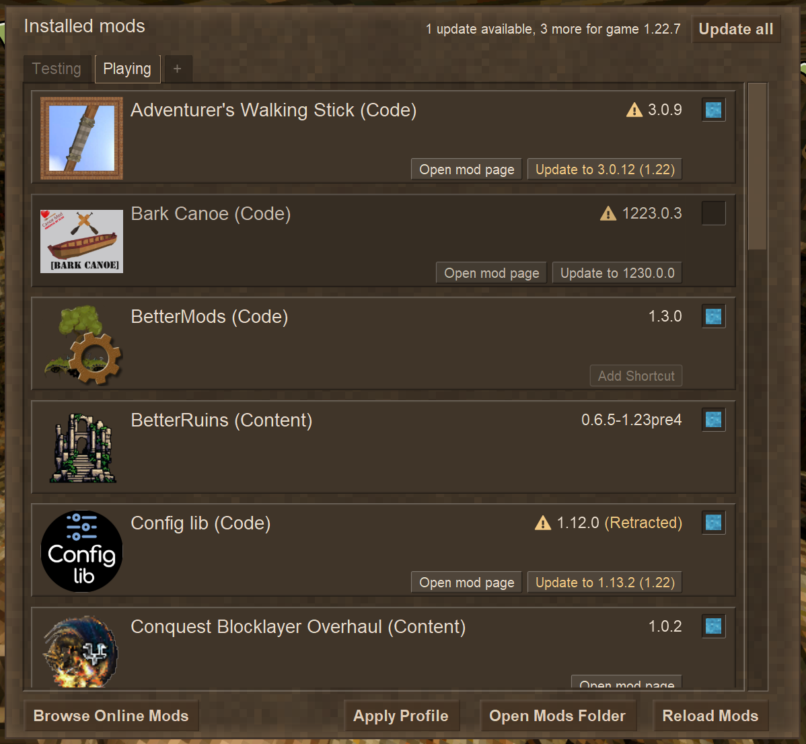
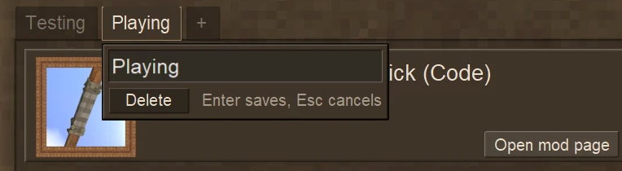
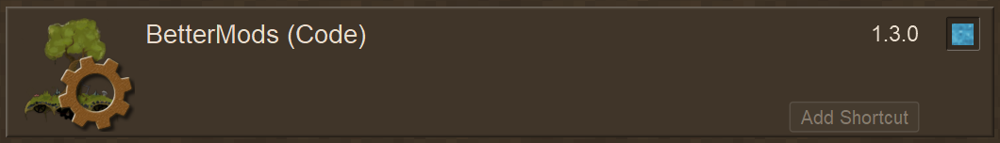
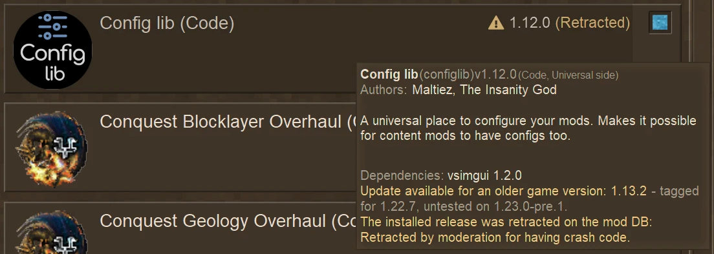
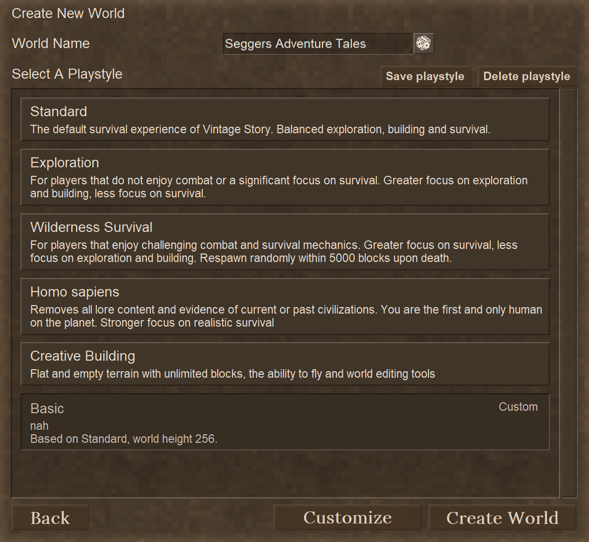

# BetterMods

Mod **profiles** for Vintage Story's mod manager. Keep several named sets of enabled and disabled
mods, switch between them with one click, pick which installed version of a mod each profile uses,
and keep your mods up to date from the mod DB - all inside the game's own Mods screen.



| | |
|---|---|
| Side | **Client only.** Servers neither need nor see it; it works on any server. |
| Game version | **Vintage Story 1.23.0-pre.1 or newer** (1.23.x). For 1.22, use the BetterMods 1.2.0 release. |
| Open it | Main menu: **Mods** screen. In game: the **Mod Profiles** dialog - bind a key to it under **Settings > Controls** (none by default). |
| Restart needed? | Only when a profile switches a mod you already used this session to a *different version*. Enabling and disabling mods never needs one. |

## Contents

- [Installing](#installing)
- [Where to find it](#where-to-find-it)
- [Profiles](#profiles)
- [The in-game Mod Profiles dialog](#the-in-game-mod-profiles-dialog-p)
- [Loading at startup (the startup hook)](#loading-at-startup-the-startup-hook)
- [Mod cards](#mod-cards)
- [Several versions of one mod](#several-versions-of-one-mod)
- [Update checking](#update-checking)
- [Open mod page and trusted links](#open-mod-page-and-trusted-links)
- [Fix dependencies](#fix-dependencies)
- [Core-mod protection](#core-mod-protection)
- [Worlds remember their profile and mods](#worlds-remember-their-profile-and-mods)
- [Saved playstyles (Accepted feature creep)](#saved-playstyles-accepted-feature-creep)
- [Multiplayer](#multiplayer)
- [Network use](#network-use)
- [Safety and fallbacks](#safety-and-fallbacks)
- [Where BetterMods keeps its data](#where-bettermods-keeps-its-data)
- [Uninstalling](#uninstalling)
- [Known limitations](#known-limitations)
- [Troubleshooting and bug reports](#troubleshooting-and-bug-reports)
- [Building from source](#building-from-source)
- [License](#license)

## Installing

1. Download `bettermods_<version>.zip`.
2. Put the zip, **as it is - do not unzip it**, into your mods folder:
   `%APPDATA%\VintagestoryData\Mods\` on Windows (the **Open Mods Folder** button on the Mods
   screen takes you there).
3. Start the game. BetterMods appears in the mod list like any other mod.

Installing it as a folder (`BetterMods.dll` and `modinfo.json` together in a folder inside the mods
folder) works identically.

> **One step more for the main menu.** The game runs no mod code until a world has loaded, so on a
> plain launch the profile tabs show up on the Mods screen only after you have loaded a world once.
> The in-game dialog works from the first world. To have everything on the main menu from the
> moment the game opens, see [Loading at startup](#loading-at-startup-the-startup-hook) - it is one
> button.

## Where to find it

- **Main menu:** click **Mods**. The profile tabs sit above the mod list, **Apply Profile** is under
  it, and the update status and its button are on the "Installed mods" heading line.
- **In game:** the **Mod Profiles** dialog has **no key by default**. Open **Settings > Controls**,
  find *Mod Profiles* (listed with the GUI controls, shown as `?` while unbound) and assign any free
  key; that key then opens and closes the dialog.

## Profiles

A profile is a named list of which mods are on and which are off. Your first profile, **Profile 1**,
is created from whatever was enabled when BetterMods first ran, so nothing changes until you change it.

- **Tabs.** Each profile is a tab above the mod list. Left-click a tab to look at and edit that
  profile. The strip scrolls when there are more tabs than fit.
- **`+`** (the last tab) creates a new profile as a **copy of the profile you are looking at**,
  named "Profile N", and switches to it.
- **Right-click a tab** to rename or delete it. A small panel opens right under the tab: type the new
  name and press **Enter** to save or **Esc** to cancel. **Delete** asks for a second click
  ("Click again to delete") before it deletes. The last remaining profile cannot be deleted, so the
  button is not shown then. Names do not have to be unique.

  

- **Viewed vs active.** The tab you have selected is the *viewed* profile - the one your clicks
  edit. The *active* profile is the one the game will actually load. Opening the Mods screen always
  starts on the active profile.
- **Toggling mods.** Clicking a mod's on/off switch edits the viewed profile only.
  - On the main menu, if the viewed profile *is* the active one, the change also goes straight to the
    game, exactly like vanilla's switch.
  - If you are viewing another profile, only that profile changes. Nothing reaches the game until
    you apply it.
- **Apply Profile** makes the viewed profile the active one: it writes that profile's on/off list
  into the game's own settings and reloads the mod list. Because it writes the game's own settings,
  the game boots with that mod set on every later launch, with or without BetterMods.
- **Deleting the active profile** applies the first remaining profile, so the game and the tabs
  never disagree about which one is active.
- **Mods the game changes itself** (for example a mod the game installs and enables when you join a
  server) are folded into the active profile, so the next Apply Profile does not silently undo them.
- **Blocked mods stay blocked.** A profile cannot re-enable a mod on the game's official blocklist.

Profiles are stored in `%APPDATA%\VintagestoryData\ModConfig\bettermods.json` (with a `.bak` copy
of the last good save). If that file exists but cannot be read - locked by another program, for
example - BetterMods shows **"Not saving - config unreadable"** and writes nothing until it can read
it again, so your profiles are never overwritten.

## The in-game Mod Profiles dialog

The same tabs, the same mod cards, the same version picker and the same **Apply Profile** - inside a
running world. It exists so you never *need* the main menu to manage profiles. It has no key by
default: bind one to *Mod Profiles* under **Settings > Controls**, and that key opens and closes it.

Toggling a mod in game edits the viewed profile only (even when it is the active one), and
**Apply Profile takes effect the next time you load a world**. Mods cannot be unloaded from the world
you are standing in. No game restart is needed - just load a world again (except for the version
case under [Several versions of one mod](#several-versions-of-one-mod)).

| | Main-menu Mods screen | In game |
|---|:---:|:---:|
| Create, rename, delete, switch profiles | yes | yes |
| Toggle mods, pick versions, Apply Profile | yes | yes (applies at next world load) |
| Card tooltips, update marker, `(Retracted)` note | yes | yes |
| Update check | yes | yes |
| Download and install updates | yes | no - the status line points you to the Mods screen in the main menu |
| Fix dependencies: switch on installed versions | yes | yes |
| Fix dependencies: download missing ones | yes | no |
| Open mod page | yes | yes |
| Add Shortcut | yes | yes |
| Prompt when starting a world with the wrong profile | yes | - |

## Loading at startup (the startup hook)

### Why it is needed

Vintage Story executes no mod code before a world loads - on the main menu it only reads mod
metadata. So on a normal launch BetterMods cannot change the Mods screen until you have loaded a world
once in that session; until then you see the vanilla screen.

The fix comes from outside the game: a small **.NET startup hook**, `BetterModsHook.dll`, which the
.NET runtime itself runs before the game starts. It waits for the game to finish starting, then
loads BetterMods' patches - so the profile tabs are on the Mods screen from the very first screen. It
does nothing else, and it changes nothing about how BetterMods behaves once a world is loaded.

### The easy way: Add Shortcut (Windows)

1. Load any world once with BetterMods installed (the button is also in the in-game dialog).
2. Find **BetterMods' own card** in the mod list and click **Add Shortcut**.
3. From now on, start the game from the new desktop shortcut **`Vintage Story (BetterMods)`**.



Starting the game any other way simply gives you the normal behaviour (tabs after the first world).
The button is greyed out once the shortcut exists - hover the card to see which shortcut it found.
If creating it fails, the Mods screen says "Add Shortcut failed" and the card's tooltip gives the
reason.

### What the shortcut does

It runs, minimised, in the game folder, with the game's icon:

```bat
%SystemRoot%\System32\cmd.exe /c if exist "<hook>" (set "DOTNET_STARTUP_HOOKS=<hook>") & start "" "<game folder>\Vintagestory.exe"
```

where `<hook>` is `%APPDATA%\VintagestoryData\ModConfig\BetterMods\BetterModsHook.dll` (and
`--dataPath` is passed on if you started the game with one).

- `DOTNET_STARTUP_HOOKS` is set **for that one launch only** - nothing on your system changes.
- It is set **only if the hook file exists**. Delete the file and the shortcut still starts a
  normal game.

### BetterMods installs and updates the hook itself

You never copy a file by hand. The hook is carried inside `BetterMods.dll`, and every time
BetterMods runs it makes sure `%APPDATA%\VintagestoryData\ModConfig\BetterMods\BetterModsHook.dll`
is identical to the copy it carries: it writes the file if it is missing and replaces it if it
differs (after an update or a downgrade of BetterMods). This works even while the game was started
through the hook - Windows will not overwrite a running hook, so the old one is renamed aside to
`BetterModsHook.dll.old-1` and removed on a later start. With `--dataPath`, the file lives under that
data folder instead.

### Why the hook cannot live inside the mod

- The .NET runtime needs a **real file on disk before the game starts**. The contents of a mod zip
  are not files until the game unpacks them, which it only does when a world loads.
- The game's unpack folder has a **different name for every release** of a mod. A shortcut pointing
  at it would break on the next update - and a startup hook that points at a missing file stops the
  game from starting at all.
- A loose `.dll` in a `Mods` folder is treated as a **broken mod**.

`ModConfig\BetterMods\` is never scanned for mods, survives mod updates, and follows `--dataPath`.

### Making the shortcut by hand (Windows)

If you would rather make it yourself, create a new shortcut (right-click the desktop >
**New > Shortcut**) and set:

| Field | Value |
|---|---|
| Program | `%SystemRoot%\System32\cmd.exe` |
| Arguments | `/c if exist "%APPDATA%\VintagestoryData\ModConfig\BetterMods\BetterModsHook.dll" (set "DOTNET_STARTUP_HOOKS=%APPDATA%\VintagestoryData\ModConfig\BetterMods\BetterModsHook.dll") & start "" "<GAME FOLDER>\Vintagestory.exe"` |
| Start in | `<GAME FOLDER>` |
| Run | Minimized |
| Change Icon | `<GAME FOLDER>\Vintagestory.exe` |

In the shortcut's **Target** box, the program and the arguments go together, separated by a space.
Replace `<GAME FOLDER>` with your install folder - the installer's default is
`%APPDATA%\Vintagestory`. If you use a custom data folder, change the two hook paths to
`<your data folder>\ModConfig\BetterMods\BetterModsHook.dll` and add
`--dataPath "<your data folder>"` after `Vintagestory.exe"`.

The Target box holds about 260 characters. If yours is cut off, use a batch file instead - save
this as `Vintage Story (BetterMods).cmd` and start the game from it:

```bat
@echo off
set "HOOK=%APPDATA%\VintagestoryData\ModConfig\BetterMods\BetterModsHook.dll"
if exist "%HOOK%" set "DOTNET_STARTUP_HOOKS=%HOOK%"
start "" "<GAME FOLDER>\Vintagestory.exe"
```

The hook file only exists after BetterMods has run once (load a world once first).

### Linux and macOS

No shortcut is made: the **Add Shortcut** button is greyed out, and its tooltip shows the exact
command for your install. The same command is written once to `client-main.log`, where you can copy
it. It has this form:

```sh
DOTNET_STARTUP_HOOKS='<data folder>/ModConfig/BetterMods/BetterModsHook.dll' '<game folder>/Vintagestory'
```

On Linux the data folder is normally `~/.config/VintagestoryData`. To keep the game launchable if the
hook file is ever missing, use a small script that only sets the variable when the file is there:

```sh
#!/bin/sh
HOOK="$HOME/.config/VintagestoryData/ModConfig/BetterMods/BetterModsHook.dll"
if [ -f "$HOOK" ]; then export DOTNET_STARTUP_HOOKS="$HOOK"; fi
exec '<game folder>/Vintagestory' "$@"
```

Use the paths from the tooltip or log line if yours differ.

> ### Warning: never set the variable globally
>
> **If `DOTNET_STARTUP_HOOKS` points at a file that is missing or is not a valid startup hook, the
> game does not start at all** - no error dialog, no game log. That is why the shortcut sets it only
> for one launch, and only when the file exists.
>
> - Do **not** set it machine-wide or per-user with `setx` or in the system environment settings.
>   Every .NET program you run would try to load the hook.
> - Do **not** edit `Vintagestory.runtimeconfig.json` (its `STARTUP_HOOKS` property). A bad path
>   there stops the game launching, every game update overwrites the file, and an uninstall leaves the
>   setting behind.

### Zip installs and the hook

The hook loads BetterMods from where the game unpacked it. A zip mod is unpacked the first time a
world loads, and every new release unpacks to a new folder. So with a zip install, the **first launch
after installing or updating BetterMods** shows the vanilla Mods screen until you load a world; every
launch after that has the tabs from the start. A folder install does not have this gap. The hook
never unpacks the zip itself - writing into the game's mod cache before the game starts could break
the mod permanently.

### Turning it off

Switching BetterMods **off in the mod manager also switches off everything the hook does**, from the
next launch. You can keep using the shortcut and still get a completely vanilla game.

## Mod cards

BetterMods redraws each row of the mod list as a **fixed-height card**: icon on the left; title and
version on the top line; a status line only when there is something wrong (a load error); and a
right-aligned row of buttons at the bottom.

- **Hover a card** for the details. The first line is the name, mod id and version, with the type
  and side in smaller text; then authors and contributors and the description (shortened if very
  long); then, after a gap, a footer with the dependencies and any update, retraction, dependency or
  error detail.

  

- **Yellow triangle** next to the version: an update is available (either kind - the tooltip says
  which).
- **`(Retracted)`** after the version, in yellow: the release you have installed was retracted on
  the mod DB. The tooltip gives the DB's reason.
- **Buttons**, as they apply: **Add Shortcut** (BetterMods' own card only),
  **Fix dependencies**, **Open mod page**, and the update button (**Update to x.y.z**, or a yellow
  **Update to x.y.z (1.22)** for a release made for an older game version). On a narrow window the
  mod page button is dropped first; the update button always stays.

If a game update changes the mod list so the card can no longer be drawn safely, the rows stay
vanilla and the update and dependency information is added to the row text instead.

## Several versions of one mod

When you have more than one version of a mod installed, they share **one card**. Its version label
gets a small drop-down arrow: click it and pick a version. That version is switched on in the
**viewed profile** and the others are switched off - each profile can use a different version.


**Restart notice.** The game cannot swap the code of a mod it has already loaded this session. So if
the viewed profile points a mod that you have already played with this session at a *different*
version, BetterMods says so: **"Restart needed - version changed"** on the Mods screen (above the
list, on the right), or "Restart the game to use the new version of ..." in the in-game dialog. It
appears only in that case - never after a fresh launch, never for a mod that is switched off, never
for content-only mods, and never for simply enabling or disabling mods.

## Update checking

BetterMods checks your installed mods against the official mod DB (**mods.vintagestory.at**) once
per session, in the background, the first time you open the Mods screen or the in-game dialog. It checks
again when you press **Reload Mods** or the status button. It never checks on a timer.

- **The exact-game-version rule.** An update is offered only when the mod DB has a newer release
  **tagged for the exact game version you are running** (for example `1.23.0-pre.1`). It only ever
  offers a newer version, and never moves a stable release onto a pre-release.
- **Releases for an older game version.** If a mod has nothing for your version, BetterMods also looks
  at the newest stable game version before yours (for example 1.22.7). Such a release is shown
  separately - a yellow **Update to x.y.z (1.22)** button, and the tooltip says it is "untested" on
  your version. Clicking it **asks you first**, and it is **not included in Update all**.

  

- **Status line** (on the "Installed mods" heading): "Checking for updates...", "N updates
  available" with an **Update all** button, "1 update only for game 1.22.7 - confirm on the card",
  "Update check failed" with **Retry**, or **"No newer releases for 1.23.0-pre.1"**. On a preview
  build few mods are tagged for it yet, so BetterMods never claims you are "up to date" - only that
  there is nothing newer for your version.
- **Not checked:** the game's own core mods, BetterMods itself, mods whose `modinfo.json` failed to
  load, and anything inside the game's install folder.

**Installing** happens only when you click **Update to ...** or **Update all**, and only on the main
menu:

- The new version is downloaded into your `Mods` folder **next to** the old one. **Old versions are
  never deleted** - they stay installed and in the version drop-down.
- **Only the profile you are viewing** switches to the new version. Every other profile keeps exactly
  the version it had.
- Safety checks on every download:
  - **https only**, and only from the mod DB (`mods.vintagestory.at`) and its download server
    (`moddbcdn.vintagestory.at`) - also checked after any redirect;
  - the file is downloaded under a temporary name first and **verified before use**: it must be a
    valid zip whose `modinfo.json` names the exact mod id and version that was asked for;
  - a file name the DB gives is checked before use, oversized downloads are refused, and
    **nothing is ever overwritten** - if a file of that name already exists, the install stops;
  - retracted and blocklisted releases are never installed.

If an install fails, the status line says why and the card's tooltip keeps the reason.

## Open mod page and trusted links

**Open mod page** appears on the cards of mods the update check found on the mod DB. Clicking it
looks up the page (once per mod per session) and opens it in your browser.

The first time, BetterMods asks: **Cancel**, **Always trust mods.vintagestory.at**, or **Open**.

- **Open** opens this page once and will ask again next time.
- **Always trust** opens it and remembers the site, so later mod pages open without asking.
- Trust only ever applies to the **mod page links BetterMods builds itself** - https pages on the
  configured mod DB site. Any other link still goes through the game's normal "open this link?"
  confirmation every time.
- **To undo it:** close the game, open `%APPDATA%\VintagestoryData\ModConfig\bettermods.json`, and
  remove the site from the `"TrustedLinkHosts"` list (or remove the whole entry). There is no in-game
  switch for this.

## Fix dependencies

When a mod that is **switched on in the viewed profile** has a dependency that is missing, switched
off, or too old, its card gets a yellow **Fix dependencies** button and the tooltip lists each
problem (for example "configlib 1.10.0 or newer: not installed").

Clicking it, for the **viewed profile only**:

1. **Prefers what you already have:** switches on the newest installed version that satisfies the
   requirement.
2. **Downloads what is missing** (main menu only): the newest release for your game version, or -
   after asking you - one for the older game version. Downloads get the same safety checks as
   updates, and other profiles are not changed by them.
3. **Follows the chain:** a newly installed dependency's own dependencies are fixed too (up to a
   sensible depth).

Anything it could not do - nothing on the DB, nothing new enough, blocked, declined, a failed
download, or in game a dependency that has to be downloaded - is listed in the status line, the
card's tooltip and the log. Nothing is half-done silently.

It will **not** fix requirements on the game itself - `game`, `survival`, `creative` or other core
mods. Those are shown in the tooltip (for example "this game provides 1.23.0-pre.1 (cannot be fixed
here)", or a core mod switched off in this profile) and left to you.

## Core-mod protection

Switching off a core mod (`game`, `survival`, `creative` and the like) in a profile asks for
confirmation first, with the game's own warning - on the Mods screen and in the in-game dialog alike.
Switching one back on never asks.

## Worlds remember their profile and mods

**Singleplayer only.** Every time you start one of your singleplayer worlds, BetterMods binds it to
the active profile, and once the world has finished loading it records which mods it actually loaded
with. On a multiplayer server none of this happens: no binding, no recorded mod list, no chat notice.

**When you start a world**, BetterMods compares and, only if something is worth asking about, shows
one prompt before the world loads:

- mods this world loaded with last time are **not enabled** in the active profile (listed by name); or
- **another profile matches this world exactly** - it enables exactly the mods the world last loaded
  with; or
- the world is **bound to a different profile** than the active one.

Version differences and extra mods never raise the prompt on their own (a newer version of a mod
usually loads fine, and adding mods to a world is normal), but they are listed if the prompt appears
anyway. If the active profile already matches the world exactly, nothing is asked.

The prompt offers:

- **Switch to <profile>** - applies the suggested profile (the exact match, or the bound profile),
  then starts the world;
- **Play with <profile>** - starts the world as it is and rebinds it to the active profile, so you
  are not asked again;
- **Cancel** (or Esc) - back to the world list.

**World list tooltip.** Hover a world on the singleplayer list to see its BetterMods profile, the mods
it last loaded with, and a note if the active profile would leave some of them off.


**Copied worlds.** A small record of the bound profile and the mod list is also stored inside the save
file itself, so it travels with a world you copy to another computer. BetterMods never writes that
record into a save that is read-only, about to be upgraded by the game, or being repaired.

If you launched without the startup hook, the first singleplayer world of the session starts before
BetterMods is running, so no prompt can appear. Instead, once that world is loaded, BetterMods posts a
`[BetterMods]` line in chat if something did not match, and suggests restarting the world from the
main menu to be offered the switch.

## Saved playstyles (Accepted feature creep)

> **Accepted feature creep.** This has nothing to do with mod profiles. It lives in BetterMods
> because a separate mod just for two buttons on one screen was not worth it.

On **Create New World**, two buttons sit at the right end of the **Select A Playstyle** row:
**Save playstyle** and **Delete playstyle** (shortened to **Save** and **Delete** when the window is
too narrow for the full labels).



- **Save playstyle** asks for a name (and an optional description) and saves the current setup as a
  playstyle of its own: the selected playstyle, everything you changed under **Customize**, and the
  world height. The **seed and world name are never saved.** It then shows up in the playstyle list
  every time you create a world - and in the Customize screen's playstyle dropdown.
- **Delete playstyle** deletes the selected custom playstyle, after asking. It is only enabled for
  playstyles saved this way - never for the game's own playstyles, for playstyles other mods define in
  their `worldconfig.json`, or for files a mod marked read-only.

In the list, a saved playstyle shows its name, a tag at the top right, its description, and a line
**"Based on &lt;base&gt;, world height &lt;n&gt;."** (for example "Based on Standard, world height 256."). The tag
is **Custom** for your own, **By &lt;author&gt;** (or **From a mod** when no author is given) for a
read-only file a mod supplied, and **Unavailable** when it cannot be used.

Picking a saved playstyle applies all of its settings and its world height (anything you customized
before is cleared, so the entry means exactly what it says); picking a normal playstyle after it puts
the height back to 256. Saving a name that already exists asks before replacing it.

**Worlds stay vanilla.** A world created from a saved playstyle is created as its *base* playstyle
(for example "Survive and Build") with the saved settings applied in full. Nothing in the world refers
to BetterMods; it loads, and lists, exactly the same without it. (The world list therefore shows the
base playstyle's name.)

A saved playstyle whose base playstyle is not installed (its mod is disabled or removed) stays in the
list, greyed out and tagged *Unavailable* with the reason, and cannot be picked. Settings for mods
that are not installed are skipped, and the row says so ("2 settings ignored: mod X not installed").

Like everything on the main menu, the buttons need a world loaded once or the
[startup hook](#loading-at-startup-the-startup-hook).

### For mod authors: the `.vsplaystyle` format

Any mod (or player) can add playstyles to that list by writing files into the same folder:

- **Folder:** `<data path>\Playstyles\` - `%APPDATA%\VintagestoryData\Playstyles\` on Windows, and it
  follows `--dataPath`. From a mod, `api.GetOrCreateDataPath("Playstyles")` returns exactly this folder.
- **File:** `<name>.vsplaystyle`, directly in that folder (no subfolders). The file name may only use
  `A-Z a-z 0-9 _ -`, 1-128 characters. UTF-8 JSON.

```json
{
  "format": "vsplaystyle",
  "formatVersion": 1,
  "name": "Hardcore Survival",
  "description": "Survive and Build with one life and harsh winters.",
  "basePlaystyle": "surviveandbuild",
  "worldHeight": 320,
  "worldConfig": { "playerlives": "1", "harshWinters": "true", "graceTimer": "0" },
  "readOnly": false,
  "author": "",
  "createdBy": "bettermods 1.x",
  "gameVersion": "1.23.0-pre.1"
}
```

| Field | Meaning |
|---|---|
| `format`, `formatVersion` | Required: `"vsplaystyle"`, `1`. A higher version is skipped (logged). |
| `name`, `description` | Shown in the list. ASCII; up to 60 and 200 characters. |
| `basePlaystyle` | Required. Code of a real playstyle (`surviveandbuild`, `exploration`, `wildernesssurvival`, `creativebuilding`, or one a mod defines). The world is created as this playstyle. |
| `worldHeight` | Optional, default 256. Rounded to the Customize slider: 128-512 in steps of 64 (128-2048 for `creativebuilding`). |
| `worldConfig` | Sparse overrides on top of the base playstyle, keyed by world-config attribute code - the same keys and values as a `worldconfig.json` playstyle. Values may be strings, numbers or booleans. |
| `settingMods` | Optional: attribute code -> mod id. Only used to explain skipped keys ("mod X not installed"). BetterMods writes it. |
| `readOnly` | `true` for files your mod supplies: BetterMods never deletes or overwrites them, and Delete is disabled for them. |
| `author`, `createdBy`, `gameVersion` | Informational. A read-only file's tag is "By &lt;author&gt;", or "From a mod" when `author` is empty. |

The effective settings are: every attribute's default <- the base playstyle's `worldConfig` <- the
file's `worldConfig`.

**Validation.** The files are **data only** - nothing in them is executed, and BetterMods reads them
as plain JSON with no type handling. At most 200 files of at most 64 KB each are read. A file that is
not valid JSON, has the wrong `format`, a newer `formatVersion`, no usable `basePlaystyle` or a bad
file name is skipped and logged. Each `worldConfig` value is checked against the attribute's own data
type: numbers in a range are clamped to its min/max, a dropdown value that is not one of its allowed
values is rejected, and text values may not contain `<` or `>`. A rejected value keeps the base
playstyle's value, and the row says how many were rejected. Keys no installed mod defines are skipped.
Two files whose names differ only in case both load; the later one's code gets `-2`.

## Multiplayer

BetterMods is **client-only** (`requiredOnServer: false`). Servers do not need it, do not see it,
and it works on any server.

- What a server makes you load is up to the server and the game's own mod download screen. Profiles
  decide only what *your* client has enabled.
- The in-game dialog works while connected; changes apply the next time you load a world or join.
- **World binding is singleplayer only.** On a server BetterMods binds no profile, records no mod
  list and posts no chat notices; the world-start prompt only ever appears for your own singleplayer
  worlds.

## Network use

BetterMods contacts only the mod DB configured in the game (by default `https://mods.vintagestory.at`)
and its download server:

| When | What is sent / fetched |
|---|---|
| First time per session you open the Mods screen or the in-game dialog; Reload Mods; the status button | The update check: your game version and the ids and versions of your installed mods (core mods and BetterMods excluded), plus the DB's list of game versions. |
| You click **Open mod page** | One lookup of that mod's page address (cached for the session). |
| You click **Update**, **Update all** or **Fix dependencies** | Downloads of the releases you chose. |

Nothing else: no telemetry, no other sites. Opening a mod page hands the address to your browser.

## Safety and fallbacks

- **A game update that breaks a patch** turns that part of BetterMods back into the vanilla
  behaviour instead of crashing. Each patch checks its target first and is skipped if the target is
  gone; the card redraw is all-or-nothing, so you get either full cards or plain vanilla rows.
- **Errors are logged, never thrown into the menu.** If the Mods screen cannot be decorated, it stays
  vanilla.
- **Other mods removing patches.** Some mods remove every Harmony patch in the game when you leave a
  world. BetterMods notices and puts its own back.
- **Turning BetterMods off** in the mod manager fully disables it from the next launch - even when you
  start the game through the startup-hook shortcut.
- **Your profiles file is protected:** an unreadable file is never overwritten, and a damaged one is
  kept as `bettermods.json.corrupt` while the last good `.bak` is used.

## Where BetterMods keeps its data

All under `%APPDATA%\VintagestoryData\` on Windows (or your `--dataPath` folder):

| Path | What |
|---|---|
| `ModConfig\bettermods.json` (+ `.bak`) | Profiles, the active profile, world bindings and recorded mod lists, trusted link sites |
| `ModConfig\BetterMods\BetterModsHook.dll` | The startup hook (written by BetterMods itself) |
| `Mods\` | Updates and dependencies BetterMods downloads, next to your other mods |
| `Logs\bettermods-hook.log` | The startup hook's own log |
| Each singleplayer save (`Saves\*.vcdbs`) | A small record of its bound profile and mod list |
| `Playstyles\*.vsplaystyle` | Saved playstyles (yours, and any other mod's) - created the first time you save one |
| Desktop: `Vintage Story (BetterMods)` | The shortcut, if you made one |

## Uninstalling

1. Remove the BetterMods zip (or folder) from your mods folder. The game keeps booting with the last
   profile you applied - that is just the game's own enabled/disabled setting.
2. Optionally, with the game closed, delete the `Vintage Story (BetterMods)` desktop shortcut,
   `ModConfig\BetterMods\`, and `ModConfig\bettermods.json`.

Leaving the hook file and shortcut behind is harmless: the hook finds no BetterMods, writes one line
to its log, and the game starts normally.

## Known limitations

- **Main-menu features need a world load or the startup hook.** Without the hook, the Mods screen is
  vanilla until you have loaded a world once in that session.
- **Zip install + hook:** the first launch after installing or updating BetterMods is vanilla until a
  world loads (see [Zip installs and the hook](#zip-installs-and-the-hook)).
- **In game, Apply Profile takes effect at the next world load**; mods cannot be unloaded from a
  running world.
- **Switching a mod you already used this session to another version needs a game restart.**
- **Downloads only from the main menu.** The in-game dialog can tell you about updates but not install
  them.
- **Mods added to the Mods folder while the game is running** are not listed until you press
  **Reload Mods**, the same as vanilla.
- **New mods start switched on in every profile.** A profile records what is off, so a mod you drop
  into the Mods folder by hand is on everywhere until you switch it off; a profile that had an older
  version of it on moves to the newest one. (Updates and dependencies BetterMods installs itself are
  the exception: only the viewed profile picks those up.)
- **ASCII text on cards.** The game's card font has no fallback, so non-ASCII characters in mod names
  and descriptions show as `?`.
- **Windows-only shortcut.** On Linux and macOS you add the launch command yourself. The shortcut
  also cannot be made if a path contains `%` or `"`.
- **Saved playstyles built on Creative Building** are not recognised as creative by the game's own
  checks on the new-world screen: the random world name is a survival one, the large-height warning
  uses the survival limit (384), and the Customize height slider tops out at 512 - so pressing
  **Apply** in Customize caps a taller saved height at 512. The world itself is created as Creative
  Building with your settings.
- **Patches the vanilla Mods screen.** Another mod that changes the same screen may conflict; if a
  patch target is missing, that part falls back to vanilla.

## Troubleshooting and bug reports

Logs are in `%APPDATA%\VintagestoryData\Logs\`:

- **`client-main.log`** - the game's client log. Every BetterMods line starts with `[BetterMods]`:
  patches, update checks and downloads, dependency fixes, installing the hook and creating the
  shortcut.
- **`bettermods-hook.log`** - written by the startup hook, one line per hooked launch saying what it
  did. If the tabs are missing on a hooked launch, this says why (including every path it looked in
  when it found no BetterMods).

When reporting a bug, please include your game version, BetterMods version, both log files, what you
clicked, and what you expected to see. A screenshot of the Mods screen helps.

Common questions:

- *No tabs on the main menu?* Load a world once, or set up the startup hook. If you use the hook,
  check `bettermods-hook.log`.
- *The game will not start after I set `DOTNET_STARTUP_HOOKS` myself?* Remove the variable (see the
  warning above) and use the shortcut instead.
- *"Restart needed - version changed"?* You picked a different version of a mod you already played
  with this session. Restart the game, or pick the version you were using.
- *"No newer releases for 1.23.0-pre.1"?* That is not "up to date": it means no release on the mod DB
  is tagged for your exact game version.

## Building from source

Requires the .NET 10 SDK and a Vintage Story 1.23 install. The projects target `net10.0` and find the
game through the `VINTAGE_STORY` environment variable - set it to your install folder (the one holding
`VintagestoryAPI.dll`). If it is not set, the build falls back to `A:\Vintagestory`.

The solution has two projects: `BetterMods` (the mod) and `BetterModsHook` (the startup hook, which
references only the .NET framework so it can load before any game assembly; it is embedded into
`BetterMods.dll` at build time). Building the solution builds both:

```powershell
$env:VINTAGE_STORY = 'C:\Games\Vintagestory'   # your install
dotnet build BetterMods.sln -c Release
```

The mod lands in `bin\Release\Mods\bettermods\` (`modinfo.json`, `BetterMods.dll`,
`BetterMods.deps.json`, `BetterMods.pdb`). Copy that folder into your `Mods` folder to try it.

To package a release by hand, zip the **contents** of that folder - `modinfo.json` and
`BetterMods.dll` must sit at the zip's root, not inside a subfolder - together with `LICENSE` and
`THIRD-PARTY-NOTICES.md`. The `.pdb` is optional. Name it `bettermods_<version>.zip`, with the version
from `modinfo.json`.

## License

BetterMods is released under the [Zero-Clause BSD licence](LICENSE) (SPDX `0BSD`): use, copy, modify
and distribute it for any purpose, no attribution required. That covers BetterMods' own code and
documentation only - Vintage Story, its API, Harmony, the mods it downloads and everything else it
links to or works with stay under their own licences and terms, which you must follow; see
[`THIRD-PARTY-NOTICES.md`](THIRD-PARTY-NOTICES.md).
